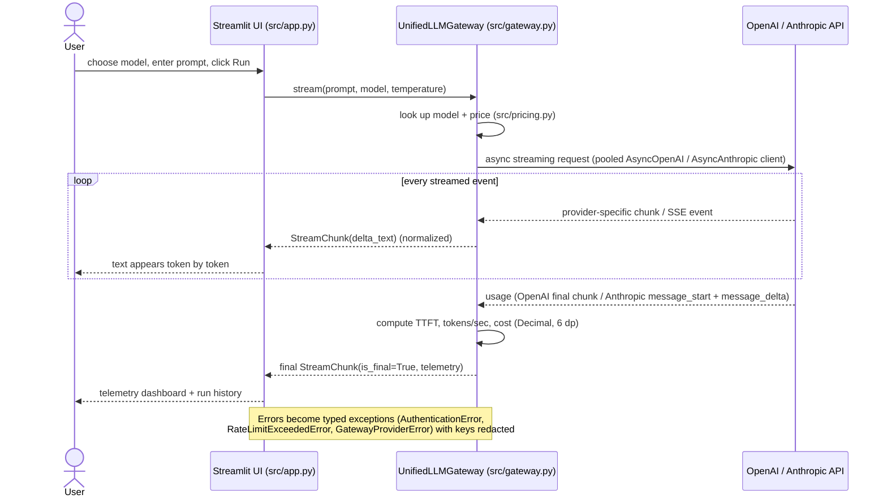

# Multi-Provider Async LLM Gateway

One async streaming interface over **OpenAI** and **Anthropic**, with real-time token, latency and
cost telemetry, plus a Streamlit web UI.

- **Live demo:** https://patie03-llm-gateway.streamlit.app
- **Video walkthrough:** https://youtu.be/xlJpLEFG-L8

## Architecture

`UnifiedLLMGateway.stream(prompt, model, temperature)` is an `AsyncGenerator` that yields the same
`StreamChunk` objects no matter which provider answers. The last chunk (`is_final=True`) carries a
`ChunkTelemetry` object with token counts, TTFT, tokens/sec and cost.



| File | Purpose |
|---|---|
| `src/schemas.py` | Pydantic v2 models: `StreamChunk`, `ChunkTelemetry` |
| `src/pricing.py` | Model catalog, prices per 1M tokens, `calculate_cost()` |
| `src/gateway.py` | `UnifiedLLMGateway`, typed exceptions, key redaction |
| `src/app.py` | Streamlit UI |
| `tests/` | `test_gateway.py`, `test_security.py`, and offline fakes |
| `ai_prompt_log.md` | The AI prompt, the original AI draft, and the audit |

**How provider differences are hidden**

| | OpenAI (Chat Completions) | Anthropic (Messages) |
|---|---|---|
| Text | `choices[0].delta.content` (can be `None`) | `content_block_delta` with `text_delta` |
| Input tokens | final chunk `usage.prompt_tokens` (needs `include_usage`) | `message_start.message.usage.input_tokens` |
| Output tokens | final chunk `usage.completion_tokens` | latest `message_delta.usage.output_tokens` (cumulative) |
| Extra events skipped | role-only chunk, finish chunk, usage chunk with empty `choices` | thinking deltas, block start/stop, `message_stop` |

## Prerequisites

- Python **3.11+**
- [uv](https://docs.astral.sh/uv/) (`curl -LsSf https://astral.sh/uv/install.sh | sh`)
- An OpenAI API key and an Anthropic API key, each with a few dollars of credit

## Setup

```bash
git clone https://github.com/patie03/multi-provider-llm-gateway.git
cd multi-provider-llm-gateway
uv sync
```

## Configuration and security

```bash
cp .env.example .env
```

Then open `.env` and paste your keys:

```
OPENAI_API_KEY=sk-...
ANTHROPIC_API_KEY=sk-ant-...
```

- `.env` is listed in `.gitignore` and is never committed. Check with `git check-ignore .env`.
- Keys are only read from the environment. They never appear in exception messages, logs or
  `repr()`: anything that looks like `sk-...` is replaced with `sk-***REDACTED***`.
- On Streamlit Community Cloud, put the same two lines in **App settings → Secrets** instead of a `.env` file.

## Run

**Web UI**

```bash
uv run streamlit run src/app.py
```

Opens at http://localhost:8501. Pick a model, enter a prompt and click **Run**. To demo error
handling, open **Error-handling demo** in the sidebar and turn on *"Send this request with an
invalid API key"*. The app shows a typed `AuthenticationError` instead of crashing, and your real
key is never changed or displayed.

**Tests**

```bash
uv run pytest -v
```

31 tests. 26 run offline using fake provider streams. 5 are **live** tests that call the real APIs
(less than $0.01 total) and are skipped automatically when no API keys are set.

| Assignment test | Test name(s) |
|---|---|
| 1. Unified stream protocol | `test_1_unified_stream_protocol_mocked`, `test_1_unified_stream_protocol_live` |
| 2. Token count within ±10% of tiktoken | `test_2_token_count_matches_tiktoken_live` (100-word prompt) |
| 3. Telemetry sanity | `test_3_telemetry_sanity_mocked`, `test_3_telemetry_sanity_live` |
| 4. Missing / malformed key handling | `test_4_*` in `test_security.py` |
| 5. Secret redaction | `test_5_*` in `test_security.py` |
| Audit fixes | `test_audit_fix_1_*`, `test_audit_fix_2_*`, `test_audit_fix_3_*` |

## Pricing matrix

USD per 1,000,000 tokens, standard tier, from the official pricing pages (verified 2026-10-09).

| Model ID | Provider | Input | Output | Notes |
|---|---|---|---|---|
| `gpt-6-luna` | OpenAI | $0.10 | $0.50 | Prompts over 272K tokens: $0.20 / $0.75 |
| `gpt-6.1-sol` | OpenAI | $2.00 | $10.00 | |
| `claude-haiku-5-5` | Anthropic | $0.10 | $0.50 | Prompts over 100K tokens: $0.50 / $2.50 |
| `claude-sonnet-5-5` | Anthropic | $2.00 | $10.00 | |

Cost = `input_tokens × input_price / 1M + output_tokens × output_price / 1M`, computed with
`Decimal` and rounded to 6 decimal places (e.g. `$0.000051`).

Sources: [OpenAI models](https://developers.openai.com/api/docs/models) ·
[Claude models overview](https://platform.claude.com/docs/en/models/overview)

> The assignment's sample prompt mentions `gpt-4o-mini` and `claude-3-5-sonnet`. These are no
> longer current, so this project uses the current equivalents above. The Claude 5.5 models and the
> GPT-6 reasoning models only accept their default temperature, so the gateway only sends
> `temperature` to models that support it (`supports_temperature` in `pricing.py`).

## Audit and verification summary

The baseline was generated by an AI assistant (full prompt and original draft in
[`ai_prompt_log.md`](ai_prompt_log.md)). A line-by-line audit found three real problems. The same
test suite **fails 4 tests on the original draft and passes all tests on the final code**.

| # | Problem in the AI draft | Fix in the final code |
|---|---|---|
| 1 | **Blocking I/O in async code.** `tiktoken` downloads its tokenizer file with a synchronous HTTP request on first use, inside `async def`, freezing the event loop. | Preload the tokenizer in `__init__`; tokenize with `asyncio.to_thread`. |
| 2 | **Leaked HTTP streams.** If the consumer stopped early (user clicks Stop), the provider stream was never closed. | `async with stream:` around each provider stream, **plus** `contextlib.aclosing()` in `stream()`. The second part was found by a failing test after the first fix. |
| 3 | **Tokens/sec understated.** Output tokens were divided by total latency, which includes the wait before the first token. | Throughput is measured over the generation window (first text → end). |

Also verified correct in the draft: async clients only (no sync calls), `None` / empty-`choices`
OpenAI chunks handled, Anthropic event types handled, TTFT measured to first non-empty text,
`Decimal` cost rounding, and clients created once and reused (connection pooling).
